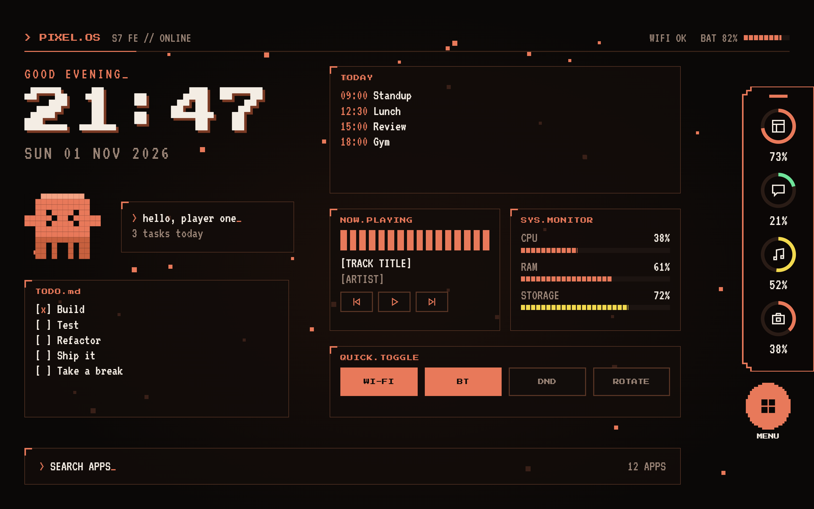
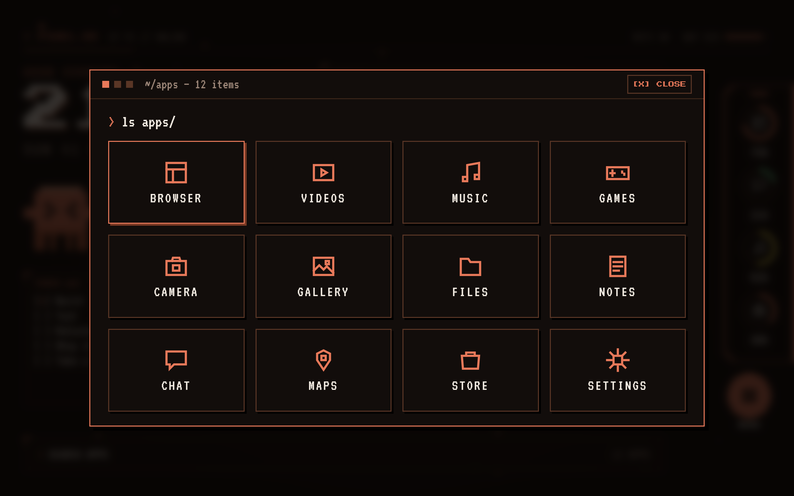
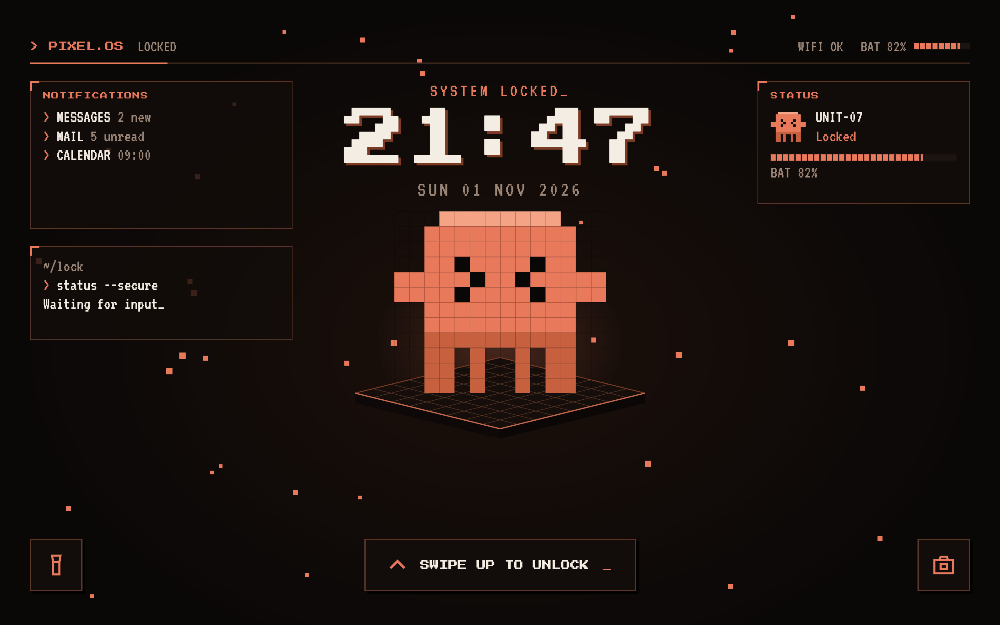

# Pixel Launcher (only for tablet, will update for any device)

A Kotlin and Jetpack Compose Android launcher with a pixel-terminal home screen, app rail, media controls, calendar preview, and a lock-screen presentation. Built for landscape tablet use, including the Samsung Galaxy Tab S7 FE.

## Screenshots





## Features

- **Home launcher:** clock, date, device-name greeting, TODO list, app search, and a searchable app menu. Set Pixel Launcher as the Home app to use it as your launcher.
- **Custom app rail:** choose up to 8 installed apps from the coral handle at the top of the rail. Four shortcuts show at a time; swipe the rail to see the rest. Tap a ring once to view today's use and tap again to open the app. Usage rings use a read-only two-hour reference.
- **Today:** shows up to two upcoming calendar items. Calendar permission is requested only when needed.
- **News feed:** shows Malaysia edition headlines from Google News. The featured story slides every 8 seconds and the feed refreshes every 30 minutes. Tap a story to open it.
- **Now Playing:** reads active media sessions, including Spotify, and provides playback buttons. The volume slider changes Android media volume. Notification Access is needed for media details and controls.
- **System Monitor:** live RAM, storage, and battery readings. Usage Access is needed only for the app usage rings, not the monitor.
- **Lock presentation:** displays the custom artwork and public notification previews when the screen wakes. Samsung's Android lock screen continues to handle secure PIN, pattern, or password authentication; this app does not implement a credential screen.

## Requirements

- Android 11 (API 30) or later
- Android SDK and Java 17
- A connected Android device or running emulator

The app is currently designed for landscape orientation.

## Build, install, and run

Open a terminal in the project folder. Connect the tablet with USB or wireless debugging, or start an emulator, then check that Android sees it:

```bat
adb devices
```

Build and install the debug version:

```bat
.\gradlew.bat installDebug
```

Press Home and select **Pixel Launcher** to open it as your home screen. To launch its activity directly from a connected device:

```bat
adb shell am start -n com.example.pixellauncher/.MainActivity
```

On macOS or Linux, use `./gradlew installDebug`.

## Optional Android access

Each permission is used only for its related feature and can be denied or revoked in Android Settings.

- **Usage Access:** reads daily foreground time for apps selected in the rail.
- **Calendar:** reads today's events for the Today panel.
- **Notification Access:** reads active media metadata and public notification previews. Notification text is kept in memory and is not saved by the launcher.
- **Display over other apps:** lets the lock presentation appear when the screen wakes. Android requires the user to grant this special access.
- **Notifications:** allows the lock-presentation foreground service to show its status notification on Android 13 and later.
- **Internet:** downloads the Google News RSS feed over HTTPS. Headlines and images are not stored by the launcher.
- **Media volume:** the volume slider changes Android's media stream volume.

Usage Access, Calendar, Notification Access, and overlay access are optional. Android or Samsung Settings may use different names or menu locations across devices.

## Switch back to Samsung One UI Home

Open **Settings > Apps > Choose default apps > Home app** and select **One UI Home**. Pixel Launcher does not uninstall or disable Samsung's launcher.

No ads, tracker, spyware etc. totally safe and standalone :)
